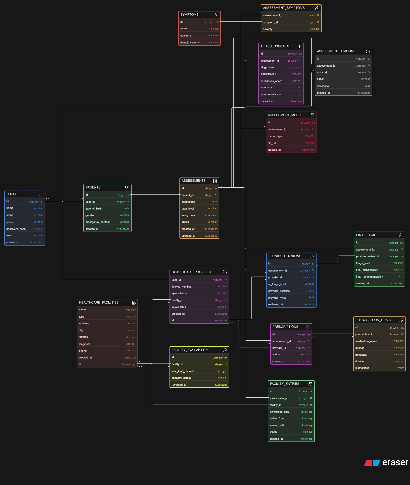

# Under Emergency | AI-Powered Medical Triage & Health Intelligence

An intelligent AI-driven web application designed to revolutionize emergency medical triage. **Under Emergency** empowers patients with rapid injury assessment and immediate first-aid guidance while providing healthcare authorities with actionable city-wide emergency analytics and predictive preparedness.

---

## Quick Links

* **Live Web App:** [Launch Under Emergency](https://areejalattas.github.io/Under-Emergency/)
* **Interactive Figma Prototype:** [Open Under Emergency Prototype](https://www.figma.com/proto/tjfBsjOOdXF7YmpWuirqpN/under-emergency?node-id=2-2225&viewport=-112%2C1013%2C0.19&t=g8sCJyntyeNSYKZQ-1&scaling=min-zoom&content-scaling=fixed&starting-point-node-id=2%3A2225&show-proto-sidebar=1&page-id=0%3A1)
* **Demo Video:** [Watch Video Walkthrough](https://drive.google.com/file/d/1qDUFizreQWyxDWFMB_kepGRk8oZzUmZ5/view?usp=sharing)
* **UI/UX Source File:** Included in the repository as `under emergency.fig`

---

## Key Features

* **Multimodal AI Injury Triage:** Analyzes uploaded injury photos alongside selected symptoms to classify urgency levels (Critical, Moderate, Mild).
* **Immediate First-Aid Guidance:** Delivers clear, step-by-step first-aid instructions tailored to the specific injury while awaiting professional medical care.
* **Smart Medical Routing:** Connects patients with the appropriate healthcare facility or provider based on availability, waiting times, and AI assessment.
* **Mobile-First Responsive UI:** Designed for rapid, intuitive interaction during high-stress emergency situations.

---

## System Workflow & Database Architecture

The relational database is engineered using **MySQL / MariaDB** to enforce data integrity via Primary Keys (PK), Foreign Keys (FK), and constraints across the core triage pipeline:

`Patient → Assessment → AI Triage → Healthcare Facility → Provider Review → Final Triage`

### Core Database Entities (`underemergency.sql`)
* Users and patient profiles
* Healthcare providers and healthcare facilities
* Patient assessments and reported symptoms / injuries
* AI-based triage results
* Assessment history and timeline
* Medical images and uploaded media
* Final triage decisions and provider reviews
* Prescriptions and prescription items
* Healthcare facility availability and waiting times
* Scheduled facility entries

### Entity Relationship Diagram (ERD)


### How to Import the Database (phpMyAdmin)
1. Open **phpMyAdmin** and create a new MySQL database.
2. Select the newly created database and open the **Import** tab.
3. Choose `underemergency.sql`[cite: 13] from this repository and click **Import**.
4. All tables, relationships, constraints, and sample test data will be generated automatically *(Note: Contains synthetic test data only; no real patient records are stored)*.

---

## Tech Stack

* **Frontend:** HTML5, CSS3, Vanilla JavaScript
* **AI Integration:** Google Gemini API (`gemini-2.5-flash`)
* **Database:** MySQL / MariaDB, phpMyAdmin
* **UI/UX Design:** Figma & Figma Make

---
---

## Future Vision & Roadmap

Beyond immediate patient triage, our long-term vision is to transform **Under Emergency** into a comprehensive, city-wide smart emergency management and preventive healthcare ecosystem:

* **Custom Fine-Tuned Medical AI Model:**
  Train a proprietary computer vision and clinical diagnostic model on verified medical datasets to achieve higher accuracy in injury classification and preliminary clinical assessment.

* **City-Wide Emergency Analytics & Root-Cause Reporting:**
  Aggregate anonymized emergency case data across neighborhoods and cities to identify the most frequent types of injuries and accidents, analyze their root causes, and deliver actionable intelligence reports to healthcare and municipal authorities for targeted prevention.

* **Predictive Seasonal & Weather Preparedness:**
  Leverage historical and seasonal data patterns (such as spikes in traffic collisions during winter fog and heavy rain) to forecast emergency surges and alert nearby hospitals in advance to optimize staffing, beds, and medical supplies.

* **Direct Hospital & EMS Integration:**
  Automatically transmit preliminary triage reports and patient geolocation to the nearest emergency room prior to arrival, reducing intake time and saving lives during the critical golden hour.

## Note for Hackathon Judges & Evaluators

For security reasons on a public GitHub repository, the live Gemini API key has been removed from the source code[cite: 3]. To test the full AI analysis functionality locally or via your own deployment, please insert your Gemini API key on **line 7** of `script.js`[cite: 3]:

```javascript
const GEMINI_API_KEY = "YOUR_GEMINI_API_KEY_HERE";
